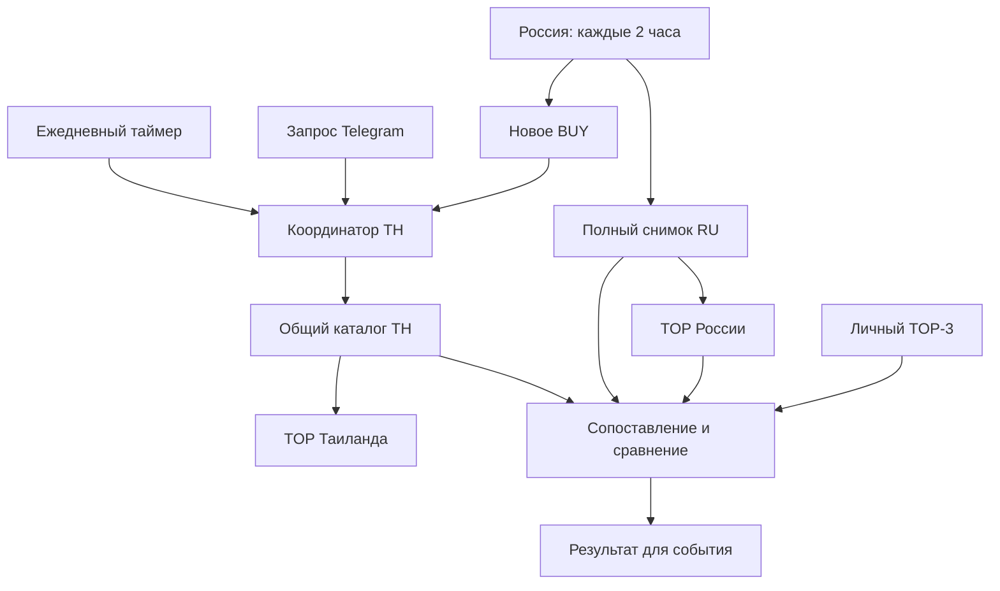

# Laptop Monitor — технический план этапа 2.2

> Архив исходного анализа. После согласования действуют [STAGE22_DECISIONS.md](STAGE22_DECISIONS.md) и [STAGE22_CONTRACTS.md](STAGE22_CONTRACTS.md), включая распределение Work A/D и Cursor B/C/E/F, время широкого discovery и уточнённые current gates. Предложения ниже не переопределяют согласованные решения.

Статус: предложение для согласования. Дата: 14 октября 2026.
Репозиторий: Andrei-Blagov/laptop-monitor.
База: v0.10.2, commit ff4d79889dbf78f78623fdac69734412c4bc42af.

## 1. Границы выполненного анализа

Через GitHub прочитаны исполняемые модули, документация, настройки deployment и существующие тесты на указанном коммите. Аннотированный тег v0.10.2 разрешается в ff4d798; main на момент чтения указывает туда же. В дереве этого коммита AGENTS.md отсутствует.

Изменения в GitHub, создание ветки, запуск тестов, магазинов, FX-запросов и Telegram-доставки не выполнялись. Production не подключался: нет информации о фактически работающем сейчас образе, данных и таймерах. Документ описывает проверенный код и предлагаемое поведение, а не результаты живой приёмки.

«Полный список» далее означает все подходящие модели из подключённых источников и фактически обследованного покрытия. Ограниченные поисковые ответы не доказывают полноту всего рынка России или Таиланда.

## 2. Что работает сейчас и что мешает целевой схеме

| Механизм | Проверенное поведение v0.10.2 | Следствие для 2.2 |
|---|---|---|
| Российский запуск | run_pipeline.py: сбор → SQLite/specs → identity → comparison → мониторинг/доставка → BUY и enqueue TH. laptop-monitor.timer запускает каждые 2 часа; timezone календаря RU явно не задан | Сохранить cadence, добавить публикацию полного согласованного снимка RU; timezone задать явно |
| Российский список | russian_deals.load_russian_ranked_deals поддерживает limit=0; без аргумента возвращает TOP_DEALS_LIMIT=10. Модели одного магазина участвуют. Свежесть latest successful attempt ≤180 минут; последний failed attempt исключает магазин | Полный список уже можно получить без нового рейтинга, но большинство downstream-вызовов получают только TOP |
| Передача в TH | job_models.build_job обрезает russian_context до 12. run_pipeline передаёт список с default limit=10 | Большую выборку передавать через ссылку на неизменяемый снимок; не расширять job произвольным массивом |
| Основное сравнение | scanner.run_thailand_scan выбирает один primary_deal; при отсутствии точной привязки может выбрать первый deal. Russian snapshot внутри TH-результата сокращён до 10 | Убрать первичную модель как границу сравнения; сигнал связывать по стабильной identity, не по равной цене или названию |
| Тайский поиск | discovery.py задаёт GPU-запросы EN/TH, затем дополнительные коды, затем rotating manufacturer lines. Основной QUERY_BUDGET=12. Поиск работает без российского TOP | Сохранить широкий поиск; отделить его план и cache key от RU TOP, личного списка и типа события |
| Тайский TOP | build_thai_top сортирует по минимальной RUB-цене. international_value_score уже есть, но value_ranked_eligible_thailand — диагностический список | Предлагается самостоятельный TOP по ценности и отдельный список самых дешёвых |
| Расписание TH | Есть ежедневный personal TOP-3 в 08:00 Europe/Moscow; отдельного общего ежедневного TH-триггера в job schema нет | Один общий ежедневный scan обслуживает каталог, TOP, сравнение стран и TOP-3 |
| Очередь | JSON pending/processing/archive/failed, atomic write/rename; active dedupe; max pending=10; stale recovery=600 секунд, max attempts=2. Manual dedupe включает минуту и тип события | Разные события способны запускать повторные сканы. Проверка dedupe и запись не защищены общей транзакцией; порядок claim идёт по случайным job UUID, а не created_at |
| Worker | Compose запускает --drain; systemd TimeoutStartSec=300. Тайские ошибки не меняют российский статус | Ограничить один запуск worker одной тяжёлой сборкой; остальное выполнить на её снимке. Общий deadline проверять по реальному времени |
| Тайские snapshots | storage.py атомарно записывает scan JSON, хранит 20 файлов; scan_id/filename имеют точность до секунды. Общего resolver для переиспользования нет | Добавить schema, UUID, reusable catalogue и отдельный derived comparison |
| Личный cache | personal_top.json хранит свой scan; TTL=26 часов; повторный manual запрещён 6 часов, daily — 18 | Сроки и историю сохранить как основу, но общий snapshot сделать источником для всех представлений |
| Сопоставление | matching.py использует мягкое сравнение CPU по классу/токенам; несовпадающее разрешение само по себе не запрещает equivalent. EXACT по MPN не делает полной проверки конфигурации. target_model.py, purchase_recommendation.py и personal_top.py имеют отдельные проверки | Объединить identity evidence и доказательство сравнимости; EXACT не должен обходить конфликты или неизвестные поля |
| Региональный SKU | В matching.match_russian_to_thai предварительно установленный SAME_FAMILY может попасть в последующую ветвь ALTERNATIVE. target_model использует другой путь | Добавить отдельную регрессию и один классификатор без перезаписи уже установленного уровня |
| Пороги выгоды | thailand/comparison.py: 3%/8%; purchase_recommendation.py: 5%/10%; personal_top.py выбирает страну по знаку любой разницы | Один расчёт разницы и единые диапазоны; отдельно оценка цен и срочность покупки |
| FX | CBR nominal поддерживается; max age=36h. Свежесть считается от fetched_at; fx_usable_for_verdict сама возраст не пересчитывает; published_date хранится отдельно | Возраст пересчитывать на каждом чтении; обновление FX не должно обновлять дату проверки магазина |
| Источники | В config включены JIB, Advice, SpeedCom, InvadeIT, IT City; BaNANA и Lazada выключены для automatic collection | Статус и лимиты сохранить; включение отключённых источников не входит в 2.2 |

Существующий shared hardware gate: RTX 5070 Ti / RTX 5080; установленная RAM ≥32 GB; SSD ≥1000 GB; числовое разрешение с шириной >1920, высотой ≥1440 и площадью ≥2560×1440; цена ≤330 000 ₽ включительно. Это актуальная конфигурация репозитория, она имеет приоритет над прежними обсуждениями бюджета. CPU и диагональ могут быть неизвестны для допуска в рейтинг, но необходимы для подтверждённого сравнения одинаковых комплектаций.

## 3. Целевая архитектура

Нужны два независимых производителя рыночных данных и чистый слой сравнения. Новый внешний брокер, база или сервис не требуются.

Порядок внутри TH: получить или переиспользовать каталог → проверить свежесть и eligibility → сгруппировать модели → сформировать собственный TOP TH → сопоставить со всем RU-каталогом → выделить совпадения с TOP RU и личным TOP-3 → сформировать рекомендации и отдельный блок без подтверждённого RU-соответствия.

Тайский TOP и сбор не зависят от наличия, состава или порядка TOP RU. RU TOP и личный TOP-3 — метки и представления результатов, а не фильтры тайского каталога.

### 3.1. Снимки и договорённости о данных

| Объект | Обязательные данные | Хранение и поведение |
|---|---|---|
| RussianMarketSnapshot | UUID, schema_version, instance_id, pipeline_run_id, captured_at, version/hash eligibility и ranking; все eligible models и их offers; стабильные model/offer IDs; полный spec evidence; все сильные manufacturer IDs; source observation timestamps/statuses; TOP IDs; exclusions и coverage | Новый JSON export в data/russian_market/. Чтение согласованного набора SQLite и specs; публикация manifest/latest атомарно после экспорта. Все модели, без TOP-обрезки |
| ThaiCatalogSnapshot | UUID, schema/parser/discovery versions, instance_id; started/finished; scope hash; raw observations; models/variants/offers; цена THB; provenance каждого поля; price_checked_at, availability_checked_at, specs_checked_at; source/query/page coverage; exclusions/conflicts; parent ID при incremental refresh | Расширить thailand/storage.py. Не смешивать с российским контекстом; старые observations не получают новый collected_at при reuse |
| FX snapshot | rate ID, source, nominal, rub_per_thb, published_date, fetched_at, validity и причина отказа | Отдельный cache; catalogue хранит THB, derived view ссылается на конкретный FX ID |
| CrossMarketComparison | UUID, RU/TH/FX snapshot IDs; profile/policy versions; matching rows, evidence, missing/different fields; comparable price pairs; membership RU TOP/TOP-3; unattributed TH rows; coverage; generated_at | Derived JSON; перерасчёт без магазинов при новом RU snapshot, FX, профиле или policy |
| Job/event | schema v2, event UUID/type, event created_at, instance, stable targets, triggering RU snapshot ID, получатели, requested view, delivery state | Job не содержит обрезанный рыночный каталог. Для текущего сравнения resolver выбирает свежий RU snapshot и сохраняет его ID; исходный BUY остаётся привязан к trigger snapshot |

Публикация RU должна иметь согласованный источник: экспорт под существующим pipeline lock; immutable specs copy/hash, read transaction либо один согласованный bulk read и проверка generation до публикации. Нельзя формировать половину snapshot до параллельной записи, половину после. Чтение snapshot не обновляет исходную SQLite.

Exporter получает весь ranked list через limit=0 и сохраняет отдельные предложения. Сравнение цены конкретной TH-комплектации ищет самый дешёвый подходящий RU offer с собственными характеристиками, а не автоматически берёт главный offer объединённого cluster. Все исходные цены и идентификаторы остаются доступны.

Путь из job разрешается только внутри настроенного data root; instance_id должен совпасть. UUID устраняет коллизии файлов в одну секунду. Retention не удаляет снимки, на которые ссылаются pending/processing, активный comparison и last-good manifest.

### 3.2. Свежесть и переиспользование — предлагаемые defaults

Это решения для согласования, а не уже реализованное поведение.

| Данные / операция | Предлагаемый предел | Правило |
|---|---:|---|
| RU offer для current selection | 180 минут | Сохранить текущую строгую политику latest attempt; failed или future timestamp не дают current price |
| TH каталог широкого поиска | 26 часов | Подходит для повторного сопоставления; после истечения нужен новый общий поиск |
| TH цена + подтверждённое наличие для актуальной рекомендации | 6 часов | Возраст проверяется по offer observation, а не finished_at снимка. Позже нужна повторная проверка предложения |
| Ежедневный общий TH scan | 08:00 Europe/Moscow | Заменяет ежедневную отдельную сборку TOP-3; если широкий scan уже был менее 18 часов назад, каталог reuse, устаревшие котировки обновить выборочно |
| FX retrieval cache | 36 часов | Повторно вычислять возраст при каждом использовании |
| FX published date | ≤4 календарных дней, без будущей даты | Предлагаемый отдельный conservative guard на старый XML; длительные праздники дают ограниченное сравнение до подтверждения актуальности официального курса |
| Повторный refresh из-за partial coverage | Не раньше Retry-After/ограничения источника | Сначала попытка использовать уже свежие наблюдения; максимум 2 попытки на refresh cycle |

Если TH-каталог моложе 6 часов и его наблюдения подходят, ежедневное/manual/BUY-событие используют один и тот же scan. Меняется только derived comparison и delivery.

Если каталог 6–26 часов: без нового широкого поиска повторно проверить offers, нужные текущему представлению. Для всего current TH TOP сначала обновить eligible кандидатов, способных войти в TOP, в пределах request budget. Если detail endpoint не поддерживается, использовать разрешённый ограниченный source refresh. Необновлённые строки остаются в «TOP последней проверки», с датой, и не поддерживают текущий вердикт. Полный широкий проход всё равно нужен раз в сутки для новых моделей.

Если snapshot отсутствует, старше 26 часов или discovery scope несовместим: выполнить общий scan. Изменение состава RU TOP, TOP-3 или типа события не инвалидирует тайский каталог. Изменение рейтинга/лимита цены пересчитывается по raw observations без сети; новый набор target GPU может требовать расширения discovery coverage.

FX error не уничтожает каталог. При неподходящем FX сохраняются THB и hardware candidates, но нет подтверждения RUB-бюджета, текущего value TOP в RUB и межстранового price verdict. Старые RUB значения показываются только как история.

Partial snapshot пригоден для положительного вывода по свежей проверенной паре: «это предложение дешевле на X». Он не доказывает глобальное «Таиланд/Россия выгоднее всех». Если RU данные устарели, TH TOP можно строить самостоятельно, сравнение стран помечается как ограниченное.

### 3.3. Координатор событий и очередь

1. Каждый новый BUY сохраняет своё событие и адресата; все actionable signals учитываются, даже если их несколько. Правила Russian BUY, 14-дневная зрелость истории и защита от повторных BUY сохраняются.
2. Координатор под межпроцессной блокировкой решает reuse / active scan / refresh / deferred. Ключ общего сбора: instance + market + discovery scope. В него не входят chat, minute bucket, RU TOP и trigger type.
3. При scan in progress новое событие становится подписчиком. Оно не теряется при слиянии и получает собственное view из опубликованного снимка. Добавление подписчика и закрытие scan выполняются под общей блокировкой; событие на границе публикации либо добавляется, либо видит готовый snapshot.
4. При готовом пригодном snapshot событие создаёт только compare/delivery job. Завершённый BUY не отправляет повторно российское сообщение.
5. Queue claim сортируется по created_at с явным приоритетом user/BUY и защитой от голодания daily; dedupe+capacity+write — одна критическая секция. Worker lock исключает два одновременных общих scan.
6. not_before и deferred jobs предотвращают повторные HTTP во время 429. Deferred не лежит в watched pending: отдельный retry timer без сети продвигает due jobs. Непустая deferred queue не запускает горячий цикл systemd.path.
7. Worker запускает максимум одну тяжёлую сборку за lifecycle; затем обслуживает объединённые события на ней. Следующий запуск подхватывает остаток. Общая 240-секундная сборка должна укладываться в 300 секунд service с запасом; HTTP-клиенты получают оставшееся deadline, а executor shutdown не ждёт неограниченно.
8. Delivery errors повторяют только доставку. Сохраняются result/part hashes и состояния pending/sent/failed; перед повторной отправкой перепроверяется свежесть. Практически exactly-once Telegram недостижим при аварии между send и сохранением статуса: этот узкий случай фиксируется как ограничение, сеть магазинов из-за него не повторяется.
9. Daily/manual/personal события не меняют BUY cooldown/state. TH worker не пишет products, store_runs и pipeline_runs в российской SQLite. TH export failure показывается отдельно от успешного RU collection.

## 4. Правила рейтинга

### 4.1. Допуск

Существующий laptop_eligibility остаётся источником аппаратных требований и лимита. В TH нужны также свежая положительная цена, подтверждённая availability, verified source evidence и variant price; trusted seller обязателен для marketplace. GPU из search query/catalog filter не становится подтверждённым GPU товара. Максимальная поддерживаемая RAM не заменяет установленную.

UNKNOWN, preorder, out_of_stock и неполные ключевые характеристики остаются в каталоге и диагностике, но не в current purchase TOP. store_pickup_only выделяется как условие самовывоза; магазин/география должны быть известны для рекомендации под доставку. Противоречивые карточки требуют проверки и не склеиваются.

### 4.2. TOP

Предлагается сохранить RU score и BUY без изменения весов. TH TOP строить по уже существующему international_value_score:

Score TH = 100 × (GPU + price/value + CPU + RAM + SSD + screen) / 88.

| Компонент | Максимум |
|---|---:|
| GPU | 25 |
| Цена к настроенной цели по GPU | 25 |
| CPU | 15 |
| RAM | 10 |
| SSD | 5 |
| Экран | 8 |

Цели сейчас: RTX 5070 Ti — 230 000 ₽, RTX 5080 — 300 000 ₽. Это пользовательские ориентиры, а не доказанная справедливая цена тайского рынка. Не вводить предположительные TGP, охлаждение, надёжность бренда или GPU benchmark в рейтинг без данных.

Сортировка: score DESC → confidence DESC → price RUB ASC → стабильный model ID. Confidence отражает доказательства и полноту отдельно, не подменяет eligibility. Неизвестные CPU/диагональ не добавляют баллы. RU score включает историю/межмагазинную экономию; его число нельзя напрямую сопоставлять с нормированным TH score. Для сравнения привлекательности разных устройств можно вывести общий international score обеих сторон как отдельную характеристику, не меняя основной RU TOP.

TOP TH по умолчанию — 5 уникальных моделей. «Самые дешёвые TH» — отдельный price ASC список. Одну конфигурацию не повторять по числу магазинов. Выбор канала доверия в существующей 2%-полосе применять только внутри доказанно одинаковой конфигурации; сохранять cheapest и preferred offer отдельно и показывать фактическую цену выбранного канала.

## 5. Сопоставление моделей

Нужно одно ядро evidence, которое используют matching.py, target_model.py, purchase_recommendation.py и personal_top.py. Повторно использовать нормализаторы product_identity.py и строгий набор comparison.CROSS_STORE_CONFIG_FIELDS; не переносить страновые имена regard/andpro из старого сериализатора как новый универсальный контракт.

Поиск кандидатов выполняется индексами сильных SKU/MPN/EAN и brand+manufacturer family+generation. Полный RU dataset остаётся доступен; top N не ограничивает кандидатов. Нечёткие названия/CPU-класс годятся только для candidate retrieval, не для доказательства.

| Класс | Доказательство | Price verdict |
|---|---|---|
| EXACT | Один полный сильный manufacturer ID, без удаления регионального или -wpro суффикса. Отдельно проверяются обязательные характеристики и конфликты | Разрешён только при completeness=confirmed и fresh/purchasable обеих сторон |
| EQUIVALENT | Подтверждена одна manufacturer family/generation, полный основной spec tuple совпал; SKU различаются, в том числе регионально | Разрешён как «одинаковые подтверждённые основные характеристики», с явной пометкой региональных/коммерческих отличий |
| SAME_FAMILY | Семейство подтверждено, но основные поля отличаются или неполны | Нет утверждения об экономии на одинаковой комплектации |
| ALTERNATIVE | Подходящее другое устройство, включая другой бренд с похожими характеристиками | Рейтинг привлекательности и сравнение отдельных цен допустимы; «та же модель дешевле» запрещено |
| NO_CONFIRMED_RU_MATCH | Ни одной подтверждённо comparable RU-пары во всём подходящем dataset | Нет процента экономии относительно России; отдельно причины candidate/conflict/incomplete/no_observation |

Обязательный spec tuple: точная модель CPU, GPU Laptop, установленная RAM, SSD, диагональ и числовое разрешение. 1 TB при 1000/1024 GB можно считать равной номинальной ёмкостью только по документированному представлению 1 TB; не применять приблизительность к произвольным ёмкостям. CPU семейства Core Ultra 9 без номера недостаточно.

Известные дополнительные различия — VRAM, TGP, refresh rate, panel type — препятствуют утверждению одинаковой аппаратной комплектации. Неизвестные дополнительные поля явно перечисляются, а вывод относится к подтверждённому основному набору. OS, клавиатура и гарантия выделяются в коммерческие различия; -wpro не объединяется с базовым SKU. Суффикс используется только для семейства и никогда не даёт EXACT.

Если одинаковый ID противоречит CPU/RAM/SSD/экрану, сохраняется identifier hit, но comparison_status=conflict; экономия и автоматическая склейка запрещены. Если ID совпадает и CPU неизвестен, статус incomplete. Проверка отсутствующих полей нужна на обеих сторонах.

Личный Lenovo 16AFR10H остаётся series profile. Конкретные варианты сравниваются как пары, но сам профиль не превращается в EXACT SKU. Изменение личного TOP-3 пересчитывает сопоставление из общего каталога.

Для каждого TH model сохранить все confirmed/candidate RU matches и три независимые метки: есть ли в полном подходящем списке, входит ли RU-партнёр в общий TOP, относится ли к TOP-3. Обратный RU→TH lookup строится из той же матрицы, чтобы ответы не расходились.

## 6. Цена, выгодность и рекомендации

Один знак и единицы во всех представлениях:

TH base RUB = price THB × rub_per_thb.
TH known total RUB = base RUB + подтверждённые расходы покупки.
Saving RUB = RU comparable price − TH known total RUB.
Saving % = Saving RUB / RU comparable price × 100.

Расчёт Decimal; округление только для вывода. При cap=330 000 не допускать стоимость чуть выше границы из-за раннего округления. Публичная базовая цена определяет стандартный tracking gate; known total отдельно проверяется против пользовательского бюджета перед рекомендацией покупки.

Предлагается унифицировать по текущим порогам purchase_recommendation: абсолютная разница <5% — сопоставимо; 5–<10% — небольшое преимущество; ≥10% — заметное преимущество. Применять симметрично. Изменение заменяет 3%/8% общего сравнения и вывод «выгоднее» по любому отклонению личного TOP.

«Дешевле на X» допускается только для confirmed сравнимой пары. «Покупать сейчас» дополнительно зависит от сохранённых RU BUY/history rules, ограничения стоимости и coverage. 14-дневная история не нужна для самостоятельного TH TOP или арифметики сравнённых котировок; незрелая история не даёт срочности по historical minimum.

FX ЦБ — ориентир пересчёта, а не гарантированный курс обмена. Подтверждённая conversion fee/spread входит в known costs при наличии пользовательских данных. Перелёт, таможня, доставка и иные неизвестные затраты не равны нулю: итог называется «стоимость с известными расходами», перечисляет неизвестные и не выдаётся за гарантированную конечную экономию. Налоговый вычет/VAT refund и voucher не предполагаются.

Частичное покрытие не запрещает показать конкретную выгодную найденную пару, но запрещает выдавать её за минимум всего рынка. Отсутствие результата поиска — «не найдено в обследованном покрытии», а при 429/timeout/непроверенных запросах — «проверка неполная», не «нет в продаже».

### 6.1. Отдельные выгодные TH-модели без соответствия

Не ограничивать этот блок одним TH TOP-5: выбирать из всех eligible TH models без confirmed RU match. Положительный смысл «выгодная» определяется самостоятельным score TH ≥75 и ценой ≤настроенной GPU target price; это предлагаемый настраиваемый порог. Статус BUY не присваивается из-за отсутствия RU-пары или TH-истории.

Показывать 3 модели по score/confidence, остальные доступны в каталоге. В карточке: характеристики, THB/RUB, магазин, дата проверки, score, причина отсутствия подтверждённого RU-соответствия и coverage. Если выгода по этому правилу не подтверждена, говорить «подходящая модель», не «выгодная».

## 7. Лимиты и качество источников

Цифры ниже — внутренние ограничения существующего кода, а не официальные квоты магазинов. В 2.2 не повышать их без отдельного решения.

| Источник | Текущие ограничения | Изменение политики |
|---|---|---|
| JIB | 12 search queries; до 24 detail requests | Central budget учитывает search+detail и оставшееся время; первые 429 прекращают весь дальнейший опрос источника |
| Advice | До 12 query requests | Не считать malformed/challenge ответ завершённым запросом; query coverage после успешного разбора |
| IT City | Bootstrap + до 12 queries ×3 pages | До 37 плановых HTTP calls; остановка по deadline/429; сохранение already collected rows при поздней ошибке |
| InvadeIT | До 8 catalogue pages и 15 specifications requests | До 23 plan calls; приоритет детализации по пригодности/недостающим полям, без привязки только к RU TOP |
| SpeedCom | 3 collections ×до 6 pages +до 12 extra queries | До 30 plan calls; после 429 сохранить собранное и честное incomplete coverage |
| BaNANA/Lazada | Отключены в automatic scan | Сохранить flags; никаких force bypass или browser probes |

Source request policy: max query/page/detail/total calls, total elapsed deadline, per-request remaining timeout, next_allowed_at и фактический request count. Успешные и неуспешные HTTP попытки учитываются; request budget не равен числу поисковых ключей.

Retry-After понимать в секундах и HTTP-date; при отсутствии сохранить fallback 60 минут. Circuit breaker: 3 transport failures → 24 часа, как сейчас. Health read-modify-write сериализовать; не применять новый timestamp к старым котировкам. Rate-limited/deferred источники сохраняют причину и следующий допустимый момент.

Детализацию планировать так, чтобы кандидаты всех брендов имели шанс проверки: hard eligibility potential, пропущенные ключевые поля, возраст наблюдения, затем score estimate; не брать неизменно первые карточки одного каталога. Сохранять очередь deferred detail work и счётчики непроверенных карточек. Региональные коды BUY/TOP-3 могут получить дополнительные bounded lookups после основных GPU-запросов, но не вытесняют широкий поиск и не меняют market snapshot key.

## 8. План изменений по модулям

Все новые имена ниже предлагаются; в репозитории они пока отсутствуют.

| Модуль | Конкретная работа |
|---|---|
| Новый market_snapshot.py | Contracts и atomic export/load RU full market; model/offer IDs, all offers/identifiers/spec evidence; manifest, compatibility и reference-safe retention |
| russian_deals.py | Разделить получение полного dataset и presentation limit; предоставить exporter модели с offers без повторного обхода БД; сохранить rank/order/BUY parity |
| run_pipeline.py | Публиковать RU snapshot каждого run; failure/partial coverage manifest; BUY события с ссылкой на него; TH export/enqueue failure не меняет RU collection success |
| storage.py, enrichment.py | Только нужный согласованный bulk-read/spec generation API; не вводить TH schema в российскую SQLite и не менять исторические данные |
| Новый thailand/catalog.py | Нормализованные TH models/variants, grouping с конфликтами, evidence и exclusions; полнота каталога независимо от RU |
| thailand/models.py, verification.py | Typed snapshot reconstruction; timestamps отдельных наблюдений; provenance specs; freshness revalidation и дополнительные подтверждённые поля |
| thailand/storage.py | UUID/schema snapshots, latest/last-good, loader reuse policy, parent/source lineage, FX/result separation, reference-safe retention |
| Новый thailand/request_policy.py | Budget/deadline/cooldown contract и план reuse/refresh/deferred для источников |
| thailand/scanner.py | Разделить collection и pure postprocessing; убрать single primary_deal границу; общий каталог публикуется до derived views |
| thailand/discovery.py, adapters | Сохранить широкий GPU discovery и caps; точное query/page coverage; preserve partial rows; bounded incremental refresh |
| thailand/grouping.py | Совпадение сильного ID плюс проверка полной конфигурации; не склеивать conflicting SKU; cheapest/preferred/alt offers |
| thailand/scoring.py, eligibility.py | Current vs last-observed view; TH value TOP/cheapest view; совместные hard requirements; Decimal budget boundary |
| thailand/matching.py, target_model.py | Один evidence classifier; exact full IDs, family+config equivalent, conservative alternatives; собственные missing/conflicts для обеих сторон |
| Новый thailand/market_comparison.py | Индексы и матрица TH×весь RU; RU TOP/TOP-3 membership; unmatched value block; deterministic outputs |
| thailand/comparison.py, purchase_recommendation.py | Общая country gap policy 5/10%; единая freshness/comparability gate; срочность отдельно от ценового преимущества |
| personal_top.py | Получение views из shared snapshot; series semantics, цели и history сохранить; daily больше не запускает отдельный scan |
| thailand/fx.py | FX cache/rehydration, age при чтении, published_date guard, Decimal; FX refresh не пересобирает магазин |
| buy_thailand_flow.py | Все actionable signals → events; стабильная связь trigger model; snapshot resolve; нет повторного Russian BUY |
| thailand/job_models.py | Schema v2 с references, event subscriptions, view/result IDs и backward compatibility v1 |
| thailand/job_queue.py, worker.py | Coordinator/worker locks; coalescing; created_at order; not_before/deferred; один heavy scan; delivery retry отдельно |
| control_bot.py, thailand/formatting.py | View из общего результата, источник/возраст, TOP TH, сравнение, TOP-3, без RU match; пагинация вместо обрезания смысла до двух сообщений |
| config.py | Предлагаемые TTL 26/6, daily time, unmatched policy, common country bands; сохранить hardware caps, цены целей и выключенные источники |
| deploy/systemd и docker-compose.yml | Один daily TH enqueue; старый personal timer убрать из независимого сбора; bounded worker/retry promoter; timezone RU явно; без двойного daily job |
| scripts/build_deploy_bundle.py, release_manifest.py | Учесть новые modules, units и docs в packaging; VERSION/теги меняются только в отдельном release этапе |
| scripts/diagnose_thailand*.py, docs | Offline snapshot/queue/comparison diagnostics и доказательства регрессий; описать defaults и совместимость |

v1 pending jobs: reader поддерживает v1/v2; v1 конвертируется в event и использует свежий общий RU snapshot. Его russian_context — trigger history, а не весь рынок. При невозможности resolve свежего RU показывать TH result без текущего country verdict. Старые TH snapshots без необходимых timestamps/evidence не получают current eligibility молча; только history/candidate либо refresh. Смена schema сама по себе не даёт права повторно отправить старый BUY.

## 9. Матрица тестов

Это план проверок, тесты в текущем анализе не запускались. Fixtures, fake clock, MockTransport, временные SQLite/JSON и конкурирующие процессы; сеть магазинов и Telegram заблокирована. Replay использует один и тот же сохранённый набор входных данных и фиксированный момент времени. Production replay возможен позже только по явно предоставленной копии.

| ID | Сценарий | Ожидаемый результат |
|---|---|---|
| R1 | В RU 25 eligible models, нужная TH-пара у RU #17 | Snapshot содержит 25; matching находит #17; TOP presentation остаётся 10 |
| R2 | RU пуст / нет BUY / TOP изменён | TH discovery и TH TOP работают одинаково; отсутствие RU не блокирует каталог |
| R3 | Single-store model и несколько цен одной комплектации | Модель участвует; нет ложного cross-store saving; offers сохранены |
| R4 | RU partial/failed latest, TTL180 boundary, future timestamp | Строгая current eligibility; история сохранена; snapshot coverage честный |
| R5 | Параллельное обновление DB/specs во время export | Snapshot одной generation либо повтор/отказ; нет mixed generation |
| C1 | TH любая марка с подтверждёнными целевыми specs | Нет allowlist TOP-3/брендов |
| C2 | TH SKU A дешевле, SKU B ценнее | Value TOP и cheapest различаются предсказуемо; TH не зависит от RU score |
| C3 | SKU одинаков, CPU/SSD/разрешение разные | Не склеиваются; conflict; нет экономии |
| C4 | SKU одинаков, CPU/диагональ неизвестны | Может пройти hardware gate, но comparable price verdict запрещён |
| C5 | Один ноутбук в трёх магазинах и marketplace | Одна TOP model; все channels сохранены; доверие влияет только внутри same config |
| M1 | Полный одинаковый MPN и 6 core fields | EXACT, confirmed; корректная пара минимальной свежей цены |
| M2 | XRU vs TH suffix, одинаковые core specs | EQUIVALENT с региональными differences; никогда EXACT; нет downgrade в ALTERNATIVE |
| M3 | Один CPU класс, разные полные CPU номера | Не EQUIVALENT; class/tokens не доказывают равенство |
| M4 | Разрешение 2560×1600 vs 3840×2400 | Не одинаковая конфигурация; запись differences |
| M5 | 1TB/1000/1024 с подтверждённой номинальной ёмкостью | Документированная нормализация, произвольные 1000/1024 без такого evidence не склеиваются автоматически |
| M6 | -wpro, другой TGP/VRAM/panel/Hz | EXACT не по обрезке; известные hardware conflicts блокируют equality; commercial differences видны |
| M7 | Другой бренд с одинаковыми 6 core fields | ALTERNATIVE, не «та же модель дешевле» |
| M8 | TH model имеет несколько RU matches/variant offers | Сохраняются все; цена cheapest comparable offer, не несовместимого cluster best |
| M9 | RU #17, RU TOP member и TOP-3 member | Все независимые membership flags; one evidence engine во всех views |
| M10 | Lenovo 16AFR10H series-only и несколько вариантов | Series candidates не превращаются в EXACT SKU; нет заимствования RAM/GPU |
| U1 | TH без confirmed RU pair, score≥75, price≤GPU target | Отдельный value block; нет saving %, BUY или утверждения об отсутствии товара в РФ |
| U2 | TH без RU pair, score<75 или выше GPU target | Подходящая, но не объявлена выгодной по unmatched policy |
| F1 | offer ≤6h, совместимый каталог | Повторные manual/daily/BUY: 0 HTTP stores; derived comparison обновляется |
| F2 | offer >6h, catalogue ≤26h | Bounded revalidation; unchanged old timestamps; no broad scan по одному событию |
| F3 | catalogue >26h / incompatible discovery scope | Один общий scan; все подписчики используют результат |
| F4 | Повторное чтение вчерашнего snapshot / fresh finished_at со старыми offers | Старые observations не становятся свежими |
| F5 | FX обновился; RU snapshot новый; profile изменён | Только conversion/ranking/matching; store HTTP=0 при свежих offers |
| F6 | FX unavailable/old fetched_at/старый published_date/будущая дата | Нет ложного RUB cap/verdict; THB и каталог сохранены |
| F7 | FX nominal не 1; точная cap цена/330000+fraction | Decimal: граница включительна, превышение не проходит из-за round |
| P1 | Saving ровно 5/10%, отрицательное/нулевое | Одинаковые bands/sign/units во всех views; unknown costs не равны zero |
| P2 | История <14 дней, strong BUY, partial coverage | Historical urgency не усиливается; confirmed pair price comparison возможен с coverage caveat |
| Q1 | Одновременно daily+несколько BUY+manual | Одна heavy сборка; все события/адресаты сохранены; no duplicate RU BUY |
| Q2 | Два coordinator/worker процесса | Atomic coalescing/claim; один scan; capacity не превышена |
| Q3 | Subscriber добавлен на границе publish/archive | Событие либо присоединено, либо использует готовый snapshot; не потеряно |
| Q4 | Queue full, enqueue retry, stale recovery, max attempts | Прежний RU success; нет resend BUY; bounded retries |
| Q5 | not_before в будущем и DirectoryNotEmpty | Deferred не вызывает busy loop; promotion без HTTP до due time |
| Q6 | Worker crash после snapshot / delivery fail | Reuse snapshot и retry delivery; магазины не опрашиваются повторно |
| Q7 | Случайные UUID и приоритет user/BUY/daily | Порядок created_at/priority, daily без голодания |
| Q8 | v1 pending job, legacy snapshot, чужой instance/path | Безопасный adapter или restricted result; нет доверия неполному payload |
| S1 | 429 на первом/позднем search или detail | 0 последующих calls к источнику; уже собранное сохранено; partial coverage |
| S2 | Retry-After seconds/date/missing и 3 transport errors | next_allowed_at/circuit соответствуют policy; budget retry ограничен |
| S3 | Query отвечает 200, но challenge/malformed/missing schema | Не считается завершённым coverage; не «рынок пуст» |
| S4 | Реальный deadline/timeout и ThreadPoolExecutor shutdown | Сбор bounded ≤240s+малый cleanup запас; service не убивается посреди unbounded drain |
| S5 | Лимиты search+pages+details, all HTTP attempts | Caps соблюдаются для каждого источника; late partial offers сохранены |
| S6 | Ниже лимита детализации много брендов | План проверки не всегда берёт первый бренд; deferred work воспроизводим |
| S7 | BaNANA/Lazada disabled | 0 обращений и probes; ограничения видны в diagnostics |
| T1 | TOP/compare/TOP-3/unmatched views на одной input pair | Совпадают price gap и evidence; различается только представление |
| T2 | Большая матрица, Telegram text limits, pagination | Нет потери значимых результатов из-за [:2]; части и callbacks стабильны |
| T3 | Не-admin, повторная команда, API send429 | Доступ защищён; доставка bounded, collection не запускается повторно |
| A1 | RU regression replay v0.10.2 и 2.2 | Одинаковы RU score/order/BUY/alerts при неизменных входах; меняется только объём export |
| A2 | TH worker с isolated roots и SQLite read-only | Российские DB rows/история/run status не меняются |
| A3 | Packaging и units | Новые modules входят в bundle; один daily trigger; reference retention безопасен; version остаётся 0.10.2 до release |

Расширять существующие test_deal_ranking_v2, test_unified_eligibility, test_saving_comparability, test_buy_opportunity, test_thailand_async_queue, test_thailand_snapshots_pipeline, test_thailand_source_health, test_thailand_spec_discovery, test_purchase_recommendation, test_personal_top и matching/target-search suites. Новые отдельные suites: market_snapshots, thailand_catalog_reuse, cross_market_matrix, thailand_job_coalescing. Тесты старой cheapest-default семантики обновлять только как явное принятие нового value TOP; hard-gate регрессии не ослаблять.

## 10. Разделение ChatGPT Work и Cursor

| Пакет | ChatGPT Work | Cursor | Условие завершения |
|---|---|---|---|
| 2.2-A Contracts и policy | Утвердить snapshot schema, invariants, freshness, matching classes и acceptance cases | После согласования реализовать schema/readers и offline fixtures в рабочей ветке | Contracts backward-compatible; тесты на legacy/freshness; никаких магазинов |
| 2.2-B RU full snapshot | Проверить отсутствие TOP cap в market data и diff против baseline | Export, integration run_pipeline, consistent read/spec generation | >12 моделей не теряются; RU parity |
| 2.2-C TH catalogue/reuse | Проверить request plan, provenance и replay | Split scanner, catalogue grouping, storage, FX, bounded source refresh | TH независим; timestamps честные; repeat events без HTTP |
| 2.2-D Match/rank/compare | Независимо проверить конфликтные пары и точность формулировок | Единый classifier, matrix, value TOP, unmatched, recommendation adapters | Все представления используют одно evidence; 5/10 bands |
| 2.2-E Queue/events | Проверить race evidence и работу без повторного BUY | Coalescing, locks, deferred, subscriptions, delivery state | Одно сканирование для concurrent events, нет потерь |
| 2.2-F Telegram/deploy/docs | UI/content acceptance по сохранённым результатам, проверка boundaries | Views/pagination, daily/retry units, package manifests, docs | Один daily scan; no automatic production change |

Cursor — основной исполнитель согласованных изменений; Work — владелец архитектуры, критериев и независимого review. Один владелец редактирования каждого пакета; Work и Cursor не меняют одни и те же файлы одновременно. Не нужны субагенты или параллельные ветки реализации.

После согласования: отдельная ветка feature/stage-2-2-thailand-market от проверенного SHA, draft PR, небольшие последовательные пакеты. Перед началом проверить текущий remote HEAD, чтобы не перезаписать новые изменения. Первый coding пакет — A+B, затем C, D, E, F. Каждый пакет проходит нужные offline tests, в конце full regression и packaging. Если часть queue contract нужна для C, интерфейс закладывается в A, поведение coalescing завершается в E.

Живые магазины, подключение production, отправка тестовых сообщений, merge, VERSION bump и release tags — отдельные действия после предъявления результатов offline-приёмки и дальнейшего решения пользователя. Согласование этой архитектуры не считать разрешением на rollout.

## 11. Решения, предлагаемые к согласованию

1. RU ranking/BUY сохранить; экспортировать полный eligible dataset независимо от TOP-10.
2. TH TOP по international value score, «самые дешёвые» отдельным списком.
3. Shared catalogue TTL26h; current purchase price/stock TTL6h; один daily в 08:00 Moscow; min18h между полными проходами при наличии пригодного каталога.
4. Один matching evidence engine; equality конфигурации требует всех 6 core fields; региональное совпадение не EXACT; другая модель/бренд — ALTERNATIVE.
5. Единые country bands 5%/10%, Decimal cap и отдельные known/unknown costs.
6. TH без confirmed RU match показывать отдельно; «выгодная» только по score≥75 и price≤GPU target.
7. Coalescing событий и повторная доставка используют общий snapshot; повторные BUY не перезапускают магазины без причины.
8. Реализация по пакетам A–F; production/release отдельным решением.

## 12. Проверенные источники GitHub

Все ссылки фиксированы на baseline commit; факты выше относятся именно к нему.

- [Тег v0.10.2](https://github.com/Andrei-Blagov/laptop-monitor/tree/v0.10.2)
- [run_pipeline.py](https://github.com/Andrei-Blagov/laptop-monitor/blob/ff4d79889dbf78f78623fdac69734412c4bc42af/run_pipeline.py)
- [russian_deals.py](https://github.com/Andrei-Blagov/laptop-monitor/blob/ff4d79889dbf78f78623fdac69734412c4bc42af/russian_deals.py)
- [deal_ranking.py](https://github.com/Andrei-Blagov/laptop-monitor/blob/ff4d79889dbf78f78623fdac69734412c4bc42af/deal_ranking.py)
- [comparison.py](https://github.com/Andrei-Blagov/laptop-monitor/blob/ff4d79889dbf78f78623fdac69734412c4bc42af/comparison.py)
- [product_identity.py](https://github.com/Andrei-Blagov/laptop-monitor/blob/ff4d79889dbf78f78623fdac69734412c4bc42af/product_identity.py)
- [config.py](https://github.com/Andrei-Blagov/laptop-monitor/blob/ff4d79889dbf78f78623fdac69734412c4bc42af/config.py)
- [laptop_eligibility.py](https://github.com/Andrei-Blagov/laptop-monitor/blob/ff4d79889dbf78f78623fdac69734412c4bc42af/laptop_eligibility.py)
- [buy_thailand_flow.py](https://github.com/Andrei-Blagov/laptop-monitor/blob/ff4d79889dbf78f78623fdac69734412c4bc42af/buy_thailand_flow.py)
- [TH scanner](https://github.com/Andrei-Blagov/laptop-monitor/blob/ff4d79889dbf78f78623fdac69734412c4bc42af/thailand/scanner.py)
- [TH discovery](https://github.com/Andrei-Blagov/laptop-monitor/blob/ff4d79889dbf78f78623fdac69734412c4bc42af/thailand/discovery.py)
- [TH matching](https://github.com/Andrei-Blagov/laptop-monitor/blob/ff4d79889dbf78f78623fdac69734412c4bc42af/thailand/matching.py)
- [TH target_model](https://github.com/Andrei-Blagov/laptop-monitor/blob/ff4d79889dbf78f78623fdac69734412c4bc42af/thailand/target_model.py)
- [TH grouping](https://github.com/Andrei-Blagov/laptop-monitor/blob/ff4d79889dbf78f78623fdac69734412c4bc42af/thailand/grouping.py)
- [TH scoring](https://github.com/Andrei-Blagov/laptop-monitor/blob/ff4d79889dbf78f78623fdac69734412c4bc42af/thailand/scoring.py)
- [TH comparison](https://github.com/Andrei-Blagov/laptop-monitor/blob/ff4d79889dbf78f78623fdac69734412c4bc42af/thailand/comparison.py)
- [TH job_models](https://github.com/Andrei-Blagov/laptop-monitor/blob/ff4d79889dbf78f78623fdac69734412c4bc42af/thailand/job_models.py)
- [TH job_queue](https://github.com/Andrei-Blagov/laptop-monitor/blob/ff4d79889dbf78f78623fdac69734412c4bc42af/thailand/job_queue.py)
- [TH worker](https://github.com/Andrei-Blagov/laptop-monitor/blob/ff4d79889dbf78f78623fdac69734412c4bc42af/thailand/worker.py)
- [TH storage](https://github.com/Andrei-Blagov/laptop-monitor/blob/ff4d79889dbf78f78623fdac69734412c4bc42af/thailand/storage.py)
- [TH fx](https://github.com/Andrei-Blagov/laptop-monitor/blob/ff4d79889dbf78f78623fdac69734412c4bc42af/thailand/fx.py)
- [TH source_health](https://github.com/Andrei-Blagov/laptop-monitor/blob/ff4d79889dbf78f78623fdac69734412c4bc42af/thailand/source_health.py)
- [personal_top.py](https://github.com/Andrei-Blagov/laptop-monitor/blob/ff4d79889dbf78f78623fdac69734412c4bc42af/personal_top.py)
- [purchase_recommendation.py](https://github.com/Andrei-Blagov/laptop-monitor/blob/ff4d79889dbf78f78623fdac69734412c4bc42af/purchase_recommendation.py)
- [control_bot.py](https://github.com/Andrei-Blagov/laptop-monitor/blob/ff4d79889dbf78f78623fdac69734412c4bc42af/control_bot.py)
- [Systemd units](https://github.com/Andrei-Blagov/laptop-monitor/tree/ff4d79889dbf78f78623fdac69734412c4bc42af/deploy/systemd)
- [Документ принятого этапа 2.1](https://github.com/Andrei-Blagov/laptop-monitor/blob/ff4d79889dbf78f78623fdac69734412c4bc42af/docs/THAILAND_SPEC_DISCOVERY.md)
- [Ограничения этапа 1](https://github.com/Andrei-Blagov/laptop-monitor/blob/ff4d79889dbf78f78623fdac69734412c4bc42af/docs/UNIFIED_ELIGIBILITY_STAGE1.md)
- [Существующие test suites](https://github.com/Andrei-Blagov/laptop-monitor/tree/ff4d79889dbf78f78623fdac69734412c4bc42af/tests)
